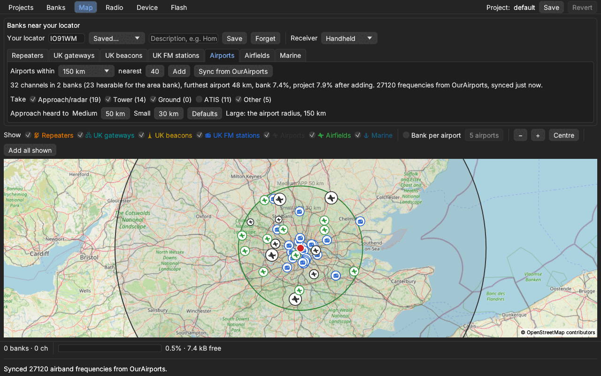
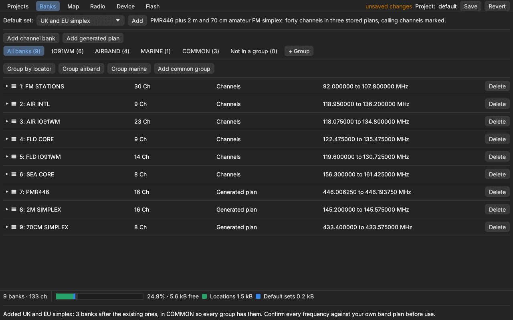
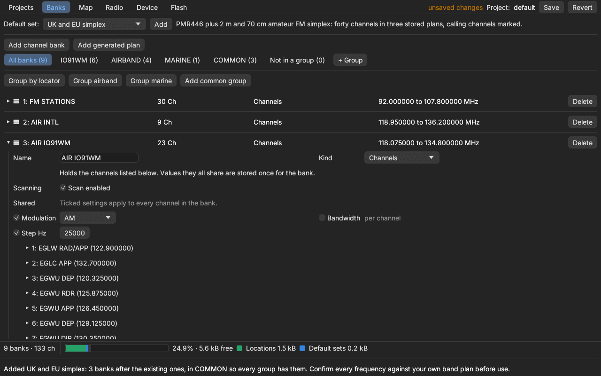
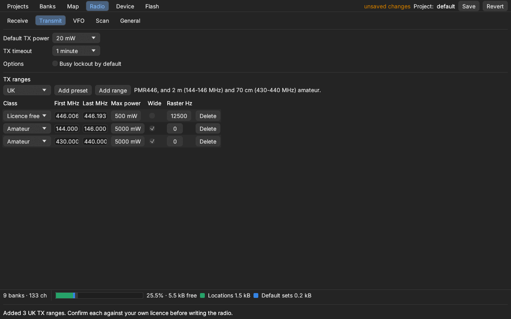
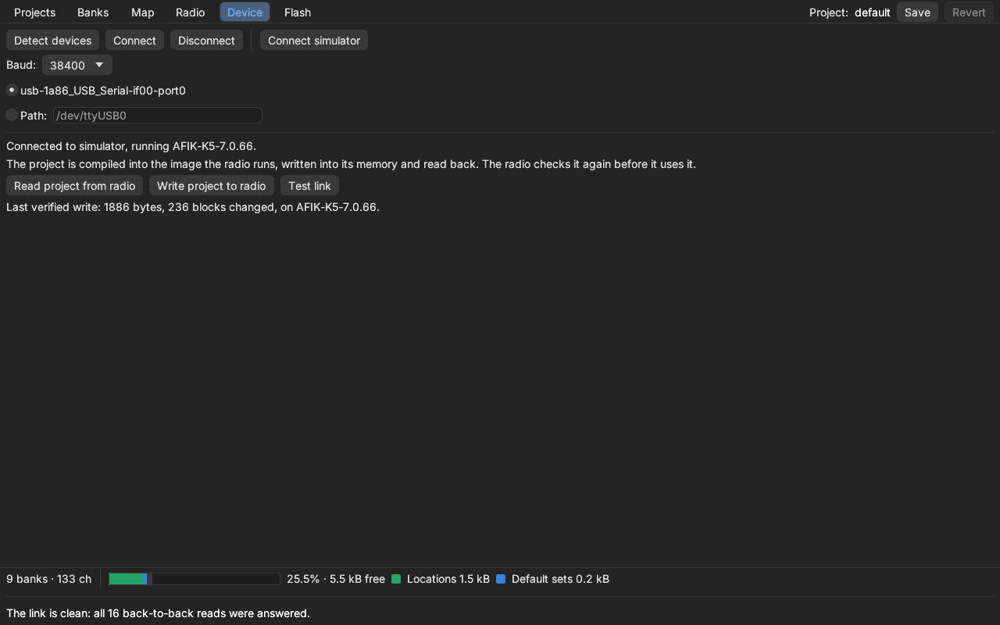
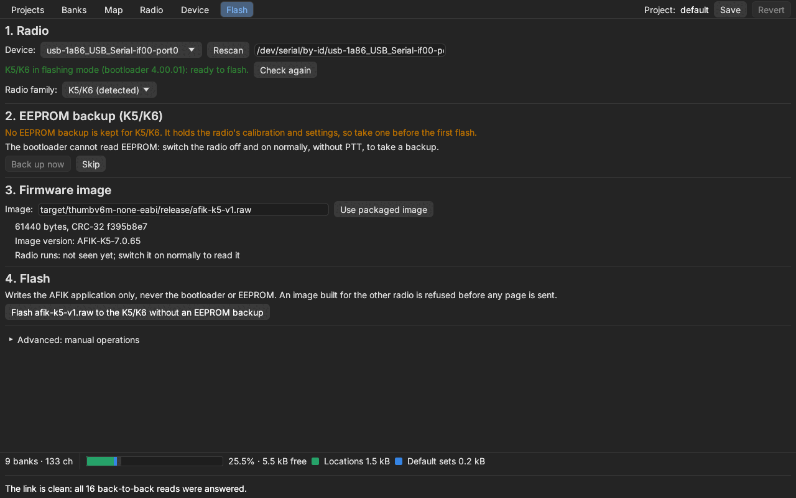
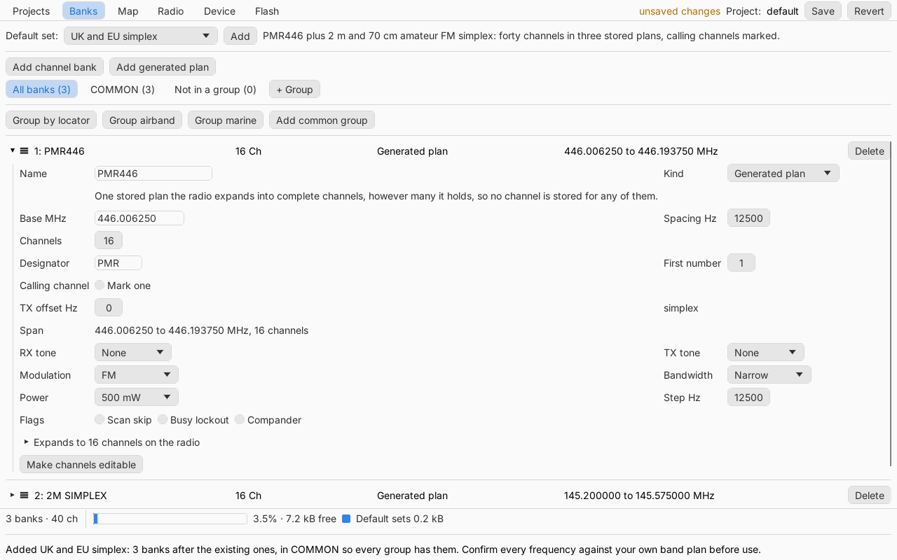

# AFIK

A ground-up Rust firmware and programming platform for the Quansheng UV-K5
(V1, DP32G030) and UV-K1 handhelds. It is not a port of the stock firmware or
its forks: the radio crates are hardware-independent, embedded code is
`no_std` and heap-free on [Embassy](https://embassy.dev), and every
transmit goes through one policy crate. It owes a great deal to
[Armel's firmware](#armels-firmware), its inspiration and working reference.

**Try it:** [AFIK Studio in the browser](https://machshev.github.io/afik/)
programs a radio over Web Serial in Chrome, Edge or a recent Firefox. Desktop
builds for Linux, macOS and Windows are on the
[releases page](https://github.com/machshev/afik/releases).

## Armel's firmware

AFIK owes a great deal to Armel F4HWN's custom firmware
([UV-K5](https://github.com/armel/uv-k5-firmware-custom),
[UV-K1 and K5 V3](https://github.com/armel/uv-k1-k5v3-firmware-custom)). It
was a huge source of inspiration, and it is an excellent alternative to this
firmware, especially on the K1.

AFIK began as a way to fit more channels into the K5 by storing channel
memory sparsely. The K1 does not have the K5's memory limit, and the new
Labs applications Armel has introduced there are really exciting: if you
have a K1, Armel's firmware is well worth a look.

AFIK is developed from the hardware datasheets. Where a datasheet is unclear,
Armel's firmware has been the working reference that shows what the hardware
really does, and much of AFIK's radio behaviour rests on it.

## Embassy

Both firmware images are built on [Embassy](https://embassy.dev), the async
embedded Rust framework: its executor runs the application's tasks, and its
timers, synchronisation primitives and futures hold them together. The K5
plugs in its own Embassy time driver for the DP32G030, and the K1 runs on
[py32-hal](https://github.com/py32-rs/py32-hal), which brings Embassy to the
PY32 family. Embassy is what makes a heap-free, no-RTOS radio application
this readable, and AFIK is grateful for it.

## What works

Both radios run the AFIK application, built from one shared application crate.

- **Receive:** FM, AM and USB through the BK4819 (BK4829 on the K1), with
  CTCSS/DCS, squelch, an S meter, and FM broadcast through the BK1080.
- **Memory:** up to 254 banks, addressed by bank and position, and bank
  groups that set what the radio scans. A generated bank stores a whole
  channel plan in one small object, which the radio expands as it is used.
- **Operation:** memory and VFO tuning, dual watch with two slots on screen,
  duplex channels heard on both sides, and fast memory scan.
- **Transmit:** FM only, and only inside the TX ranges the project
  programs (span, power ceiling, wide FM, raster), in channel and VFO mode
  alike; a radio with none programmed does not transmit. Beneath the
  ranges, both radios allow Armel's calibrated bands from 18 MHz to 1.3 GHz
  less the chip's 630–840 MHz gap, at six levels from the unit's own
  calibration (nominally 20, 125, 250 and 500 mW, 2 W and 5 W), lowered to
  the range's ceiling; a band the unit has no calibration for is refused.
  The power figures are nominal, not measured, and the K5's PA and filters
  are designed for 2 m and 70 cm only (`RISK-040`, `RISK-044`). K1 transmit
  is implemented and still being bench checked.

What has and has not been observed on each radio is recorded per task in
`TASKS.md`, with the hardware facts and their confidence in
`docs/hardware-evidence.md`.

## AFIK Studio

Studio is where a radio's channels and settings are made: a project holds
the banks and groups, the radio configuration, the TX ranges, and the slots
and VFOs the radio starts on. Studio compiles and validates the project
before writing it; the radio takes it as memory blocks over the stock
programming protocol and validates it again before using it (`ADR-100`).

```sh
afik-studio            # desktop
afik-studio --sim      # with a simulated radio
afik-studio --help
```

### Map: banks near you



Enter a Maidenhead locator and Studio finds what you can hear there:
repeaters (worldwide from hearham, UK from the ETCC, Israel from the IARC), UK gateways and
beacons, FM broadcast stations (UK from Ofcom, US from the FCC), airport and airfield
frequencies from OurAirports, and marine channels from OpenStreetMap. Each
is drawn on the map with the distance it is heard to, which follows the
receiver you choose (handheld, mobile or base station). **Add all shown** turns them
into banks, grouped by locator.

### Banks and groups



A radio holds up to 254 banks. A bank is either a list of channels or a
generated plan, such as PMR446 or a 2 m simplex band, that the radio expands
itself, so a whole band costs one small object. Default sets add common
plans in one go. Groups decide what the radio scans together, and the bar
at the bottom shows how much of the radio's memory the project uses.



Settings every channel in a bank shares (here AM and a 25 kHz step) are
stored once for the bank rather than in each channel.

### Radio: receive, transmit, VFO, scan



The Radio tab sets squelch, dual watch and the other receive options, the
VFOs, scanning and general settings. Transmit holds the TX ranges: the only
places the radio will transmit, each with its own power ceiling, bandwidth
and channel raster. Presets add the UK, EU (CEPT), US, marine and CB ranges;
check each against your own licence.

### Device: write, read and test



Connect a radio (or the simulator), write the project, and read it back.
Each write is verified by reading it back, and **Test link** sends
back-to-back reads to show at a glance whether the cable is reliable.

### Flash: install AFIK



The Flash tab walks through installing AFIK: it detects the radio and its
family, suggests an EEPROM backup (which holds the radio's calibration),
picks the packaged image, and writes the application only, never the
bootloader or EEPROM.

### In the browser



[Studio in the browser](https://machshev.github.io/afik/) is the same code
built for WebAssembly (`ADR-119`), reaching the radio over Web Serial in
Chrome, Edge or a recent Firefox. It keeps projects in the page's storage.
Firmware flashing and the list and map downloads are desktop-only for now.
See `docs/programmer-gui.md`.

## Releases and installation

Each `vX.Y.Z` tag publishes the K5 and K1 firmware images and the host tools
(`afik-studio`, `afik-flasher`, `afik-programmer`) for Linux x86_64/aarch64,
macOS Apple Silicon/Intel and Windows x86_64, with `SHA256SUMS`. The macOS
and Windows binaries are unsigned. Serial ports are named as the system
names them: `/dev/ttyUSB0`, `/dev/cu.usbserial-110` or `COM3`.

With Nix, `nix run github:machshev/afik` starts Studio from the pinned
release, and `nix shell github:machshev/afik` puts the tools on the path,
with the firmware images in `share/afik/firmware`.

## Flashing firmware

`afik-flasher` (and Studio's Flash tab) writes AFIK to either radio from its
stock bootloader. It reads the bootloader beacon to tell the K5 V1 `2.*` and
K1 `7.03.*` protocols apart and refuses an image built for the other radio:

```sh
afik-flasher identify
afik-flasher flash-afik [IMAGE]
afik-flasher link-test
```

Without IMAGE it uses the packaged image for the radio that answered. Only
the application region is written; the bootloader and EEPROM are left alone,
so an image that does not boot is recovered by flashing another. The K5's
recovery-gated paths (`flash-afik --recovery`, `restore-eeprom`) need a
complete EEPROM backup, a known-good raw image and exact confirmations. A
bootloader beacon proves only the protocol family, not the board. Read
`docs/k5-flashing.md` before connecting a K5; V2/V3 radios and bootloader v5
are not supported.

## Other tools

`afik-programmer` is the command-line programmer for AFIK's own framed
protocol, usable against the deterministic simulator:

```sh
afik-programmer --sim info
afik-programmer --sim write --bank '1:PMR446:446006250:12500:16'
```

See `docs/programmer-cli.md` and `docs/simulator.md`.

## Development

Everything builds in the pinned Nix development shell (`nix develop`, or
`direnv allow` once). Host checks:

```sh
cargo fmt --all --check
cargo clippy --workspace --all-targets -- -D warnings
cargo test --workspace
```

Firmware images:

```sh
tool/build-k5.sh --release
tool/build-k1.sh --release
tool/test-k1-image.sh
```

A release build verifies the ELF and packages the raw image
(`afik-k5-v1.raw`, `radio-firmware-k1.raw`) beside it, which
`afik-flasher flash-afik` picks up by default. The K5 image is exactly the
60 KiB V1 application region.

The browser Studio:

```sh
cd crates/radio-programmer-gui && trunk serve --release
```

The `pages` workflow publishes it from `main`, and the `release` workflow
builds the release packages from a `v*` tag. After a release, pin it for Nix
with `tool/update-release-nix.sh` and commit `nix/release.json`. Firmware and
tool versions come from the workspace `version` in `Cargo.toml`.

`STATUS.md` holds the current work and the verified commands, `TASKS.md` the
tasks, `DECISIONS.md` the decisions, `RISKS.md` the open risks, and
`docs/architecture.md` the crate boundaries.
